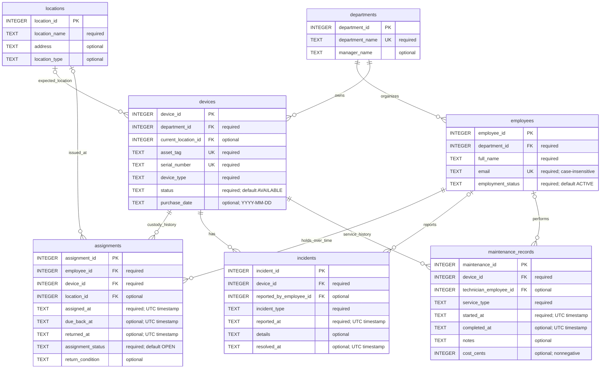

# Final entity–relationship diagram

This diagram matches `schema.sql`. GitHub renders the Mermaid block below. `PK`, `FK`, and `UK` denote primary, foreign, and unique keys. Required attributes are NOT NULL; optional attributes allow NULL. Integer primary keys identify each record and are assigned automatically when omitted.

Each department can have zero or more employees/devices. Every assignment requires a device and employee; an issue location may be unknown. Expected locations, incident reporters, and maintenance technicians can also be unknown. Referenced records cannot be deleted while dependent records exist (`ON DELETE RESTRICT`).

Assignments resolve the employee/device many-to-many relationship over time. A partial unique index permits only one OPEN assignment per device. Triggers reject overlapping custody intervals. These temporal rules supplement the diagram's cardinalities.

The earlier PNG contained the same entities and columns but omitted the required employment status and showed mandatory relationships for some nullable locations/reporters/technicians. This final diagram corrects those annotations to match the existing SQL. The database itself was not changed. Allowed codes, chronological checks, and the accountability view are defined in full in `schema.sql`.
